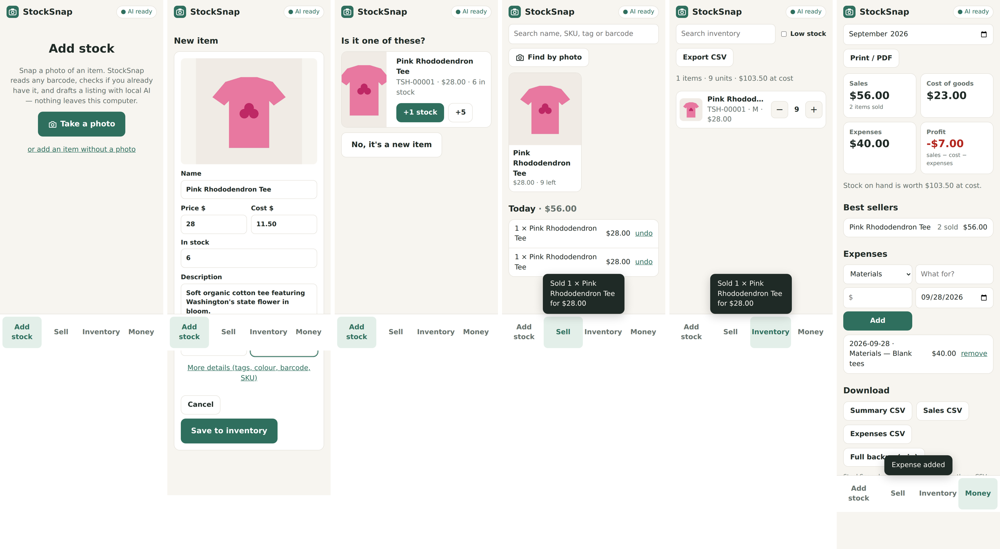
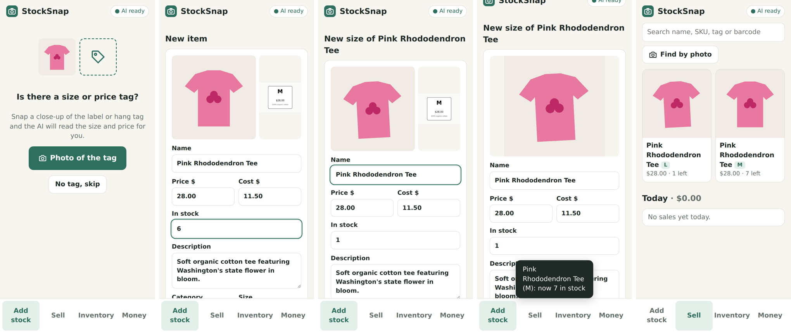
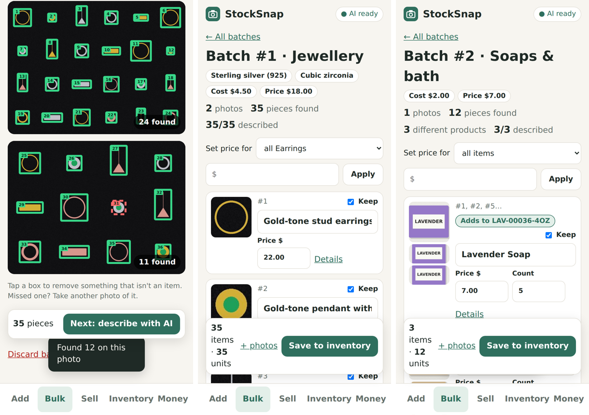

# StockSnap

**Offline, open-source inventory and bookkeeping for makers and micro-retailers, with local AI.**

Snap a photo of an item, plus an optional close-up of its size or price tag. StockSnap reads any barcode, recognises items you already stock, and uses a local vision-language model to draft the name, description and tags. It also reads the **size and price straight off the tag**, so items with no barcode still get listed without typing. Selling takes one tap, stock updates on its own, and the Money tab shows what you earned this month. It all runs on your laptop, so no subscription is needed and none of your data leaves your device.





| Add | Bulk | Sell | Inventory | Money |
|---|---|---|---|---|
| Photo (+ tag close-up) → barcode → "do I already have this?" → AI-drafted listing with size & price | Hundreds of items from a few tray photos: counted, numbered, described, barcode tags printed | Tap a tile or snap a photo to sell; undo mistakes | Search, low-stock flags, ± stepper, CSV export | Profit, expenses, **stock by month** (start, added, sold, end); CSV + print to PDF; full backup |

## Bulk add: 500 pieces from a few photos

Wholesale lots arrive in bulk: a bag of 500 machine-made earrings, or a carton of soaps. Photographing them one at a time doesn't work, so StockSnap can take a whole tray at once.

1. **Pick the product type.** Jewellery, soaps & bath, candles, or something else. Each comes with a **photo guide** (which background to use, how far apart to lay things out, how many per photo).
2. **Answer a few questions once per batch.** These cover what the camera can't see: metal, stones, nickel-free, wax type, cost and price. The answers apply to every item in the batch, so the AI never has to guess a metal.
3. **Photograph the trays.** StockSnap finds every item, draws a **numbered box** on each and counts them. Tap a box to drop anything that isn't an item.
4. **Local AI describes them in the background.** It works out the type, colour, finish and style, and on packaged goods **reads the label** (name, scent, weight).
5. **Review in one list,** set prices in bulk ("all earrings $22"), then **save**. Every item gets its own SKU and a **sheet of barcode tags** prints in tray order: tag #1 goes on piece #1.

Two counting modes:

- **One of a kind** (jewellery): every piece found becomes its own item and ID.
- **Identical goods** (soaps, candles): look-alikes are grouped and counted, with one AI call per product rather than per bar. Groups whose labels read the same are merged, and a product you already stock is **restocked** instead of duplicated. For a full carton, type the count.



**Photo setup:** use a **matte black** background (velvet, felt, foam board) for gold, silver, pearls and bright items, and **plain white card** for dark items. Shoot in daylight with no flash, phone straight overhead, with a finger-width gap between items. Earring pairs should touch, so each pair counts as one.

## Why

Home-based sellers, craft makers and small boutique owners usually juggle spreadsheets, notebooks and a partial POS. The tools built for them tend to be subscription-based, cloud-only, or built for enterprise. StockSnap is aimed at the **handmade seller at a weekend market**: fast enough to use at the booth, simple enough to use without accounting knowledge, and private because everything stays on your machine.

See [docs/PROBLEM_AND_REQUIREMENTS.md](docs/PROBLEM_AND_REQUIREMENTS.md) for the full problem statement and scope.

## Open-source AI stack

| Job | Model / library | Licence | Runs |
|---|---|---|---|
| Draft name, description, tags from a photo; read size & price from a tag | **Qwen2.5-VL 3B** via [Ollama](https://ollama.com) (or `moondream` for low-end laptops) | Apache-2.0 | Local, CPU or GPU |
| "Which of my items is this?" | **OpenCLIP ViT-B/32** (optional) or the built-in lite colour/shape matcher | MIT | Local |
| Barcodes (UPC, EAN, Code128, QR, …) and printed SKU tags | **zxing-cpp** | Apache-2.0 | Local |
| Finding and counting items on a tray photo | **OpenCV** | Apache-2.0 | Local, instant on CPU |
| Storage | SQLite | Public domain | Local file |

Every AI step is **optional and fails gracefully**. If Ollama isn't running, you type the details yourself and everything else still works.

## Quick start

Prerequisites: Python 3.10+ and Node 20+.

```bash
# 1. Local AI (one-time, ~3 GB download)
#    Install Ollama from https://ollama.com, then:
ollama pull qwen2.5vl:3b          # or: ollama pull moondream  (smaller, faster)

# 2. Backend
cd backend
python -m venv .venv
.venv\Scripts\activate            # Windows   |   source .venv/bin/activate  (Mac/Linux)
pip install -r requirements.txt

# 3. Frontend (build once)
cd ../frontend
npm install
npm run build

# 4. Run - one process serves the API and the app
cd ../backend
uvicorn app.main:app --host 0.0.0.0 --port 8000
```

Open **http://localhost:8000**. To use your **phone's camera**, connect the phone to the same Wi-Fi and open `http://<your-laptop-ip>:8000`.

### Optional: better visual matching (CLIP)

```bash
pip install torch --index-url https://download.pytorch.org/whl/cpu
pip install -r requirements-ai.txt
```

The weights download once (~350 MB), and after that matching runs offline. Without CLIP, StockSnap falls back to a lightweight matcher. That matcher works best when photos are taken in similar light and against a similar background.

### Development

```bash
cd backend && uvicorn app.main:app --reload          # API on :8000
cd frontend && npm run dev                           # UI on :5173 (proxies /api)
cd backend && pip install -r requirements-dev.txt && pytest
```

API docs are auto-generated at http://localhost:8000/docs.

## Configuration

All settings are environment variables with sensible defaults:

| Variable | Default | Purpose |
|---|---|---|
| `STOCKSNAP_DATA_DIR` | `~/.stocksnap` | Database and photos |
| `OLLAMA_URL` | `http://localhost:11434` | Local Ollama server |
| `STOCKSNAP_VISION_MODEL` | `qwen2.5vl:3b` | Any Ollama vision model |
| `STOCKSNAP_VISION_TIMEOUT` | `120` | Seconds to wait for the model |
| `STOCKSNAP_MATCHER` | `auto` | `auto` / `clip` / `lite` / `off` |
| `STOCKSNAP_MATCH_THRESHOLD` | `0.80` | Minimum similarity to suggest a match |

## Project layout

```
backend/
  app/
    main.py            FastAPI app factory; also serves the built UI
    models.py          SQLModel tables (Item, Sale, Expense), money in cents
    routers/           items, scan, sales & expenses, reports, system
    services/          barcode, vision (Ollama), matcher (CLIP / lite), images
  tests/               pytest suite (AI faked for speed)
frontend/
  src/pages/           Add stock, Sell, Inventory, Money
  src/components/      PhotoButton, ItemForm
docs/                  problem & requirements, architecture
```

## Roadmap

- [x] Printable SKU barcode labels
- [x] Bulk add from tray photos (jewellery, soaps, candles, other)
- [x] Stock by month with a full stock ledger
- [ ] Import supplier invoices / packing lists to fill in metal, cost and quantities
- [ ] SAM 2 segmentation as an option for busy backgrounds
- [x] Sizes: read from tag, "different size" of an existing product, duplicate-size guard
- [ ] Full variant matrix (size × colour) under one parent product
- [ ] CSV import from Etsy / Square / Shopify exports
- [ ] Optional sync (local-first, e.g. CRDT or self-hosted)
- [ ] Packaged desktop installer (Tauri or PyInstaller)
- [ ] PWA install on phone

## Licence

MIT. See [LICENSE](LICENSE).
