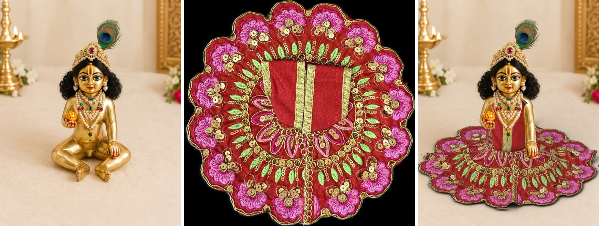

# Experiment: dress the idol with a 3D cloth model (Blender)

**Goal:** listing photos of an idol *wearing* each dress, free and offline, with the
real embroidery unchanged.

**Idea:** the flat-lay photo of a Laddu Gopal dress *is* the fabric in its flat state:
the skirt is a ring of cloth. So the script builds a flat 3D ring, puts the
photo on it pixel for pixel, and lets Blender's cloth simulation drape it over
simple stand-in shapes of the seated idol (body, crossed legs, floor). The bodice
wraps round the front of the body. The render goes onto the bare idol photo,
and the idol's arms, ball and necklace are laid back on top.

The embroidery is never redrawn, only bent with the cloth, so colours and motifs
stay true.



| | |
|---|---|
| Time per dress | about 1.5 min on a laptop CPU (cloth simulation + Cycles render, 32 samples) |
| Needs | Blender 4.2 or newer (free). No GPU, no AI model, no extra Python packages |
| Tested | Blender 4.5.4 LTS, one dress, one idol photo |

## What works and what doesn't yet

Works:
- The skirt really drapes: it comes from the waist, flows over the crossed legs and spreads on the floor, with natural folds.
- The real embroidery, sequins and colours stay where they are on the dress. The front placket runs down the front.
- The arms, the hand with the ball and the necklace are in front of the dress.
- Same setup for every dress: only the dress photo changes.

Not yet:
- **The top is a sleeveless vest** (like these dresses are worn): from the waist to a round neckline, with armholes; the bodice photo spans the front between the armholes, so its edge trims become the armhole trims. Set `armhole_deg` to null for a top with sleeves. The flat photo only shows the front; the back is never seen.
- **Stand-in shapes are rough.** They are boxes and ellipsoids sized by eye. A better match to the idol (especially the legs) gives a more natural drape.
- **Sequins look flat.** They don't glint as they do in real light.
- The keep-on-top outlines (arms, necklace) were drawn roughly by hand.

## Run it (Windows, Git Bash)

1. Install Blender from <https://www.blender.org/download/> (free, version 4.2 or newer).
2. Put the photos in this folder:
   - `idol_bare.jpg`: the idol without clothes (the one we used).
   - `dresses/`: one flat-lay photo per dress, shot from straight above on a plain dark background, the whole dress visible, bodice laid upward (like `dress.jpg`).
3. One dress:
   ```bash
   cd /c/Projects/stocksnap/experiments/blender-dress
   "/c/Program Files/Blender Foundation/Blender 4.5/blender.exe" -b -P dress3d.py -- dress.jpg idol_bare.jpg out.png
   ```
   (change `4.5` to your Blender version). About a minute and a half; the result is `out.png`.
4. All dresses:
   ```bash
   bash run_all.sh
   ```
   Results go to `out/<dress name>.png`. 50 dresses take about an hour and a quarter.

## Settings (`setup.json`)

Set **once per idol photo** (`scene`, in units where 1 = width of the crossed legs):
- `camera.anchor_px`: pixel of the idol's waist centre in the idol photo. `px_per_unit`: width of the crossed legs in pixels. `tilt_deg`: how much the camera looks down.
- `torso`, `lap`: stand-in body and legs that the cloth lands on.
- `skirt_radius`: how big the dress is on the idol (bigger = wider spread). `waist_height`, `waist_radius`: where the skirt is attached.
- `bodice`: the top. Heights `bottom` (waist), `shoulder`, `neck`; radii `radius` (waist), `chest_radius`, `neck_radius`; `cover_deg` (how far round the body), `neckline_deg` / `neckline_drop` (width and depth of the front neckline); `armhole_deg` / `armpit_at` (sleeveless top: where the armholes are; null = sleeves); `centre_px` (the front opening in the dress photo); `edge_px` / `top_px` (how far in from the photo's edges the plain fabric is).
- `keep_on_top`: outlines (pixels in the idol photo) of what stays in front: the arms *below the sleeve edge*, the hand with ball, the necklace. `shade_under_sleeve` lists which of them get a soft shadow under the sleeve.

Per dress (`dress_photo`):
- `skirt_centre`, `skirt_radius_px`: measured automatically from the photo (leave `null`).
- `bodice_box`: `[left, top, right, bottom]` of the bodice in the dress photo, in pixels. If every dress is photographed the same way, one value fits all. Otherwise put a file next to the photo with the same name, e.g. `dresses/red.json` containing `{"bodice_box": [400, 330, 900, 650]}`.

`work/dress_render.png` is the dress alone (transparent background), useful for checking.

## Next steps if this is the way

1. Better stand-in shapes, fitted to the idol photo once.
2. Top shapes for other cuts (long sleeves, collars).
3. Exact camera match (fSpy) instead of the hand-set orthographic camera.
4. Exact keep-on-top masks (click-to-select) instead of hand-drawn outlines.
5. Hook into StockSnap's listing photos.
