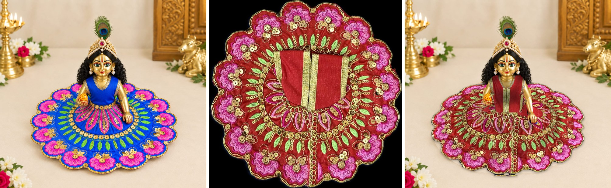

# Experiment: swap the dress in a photo of a dressed idol

**Idea:** start from a photo where the idol is *already wearing* a dress of the same
cut (here an AI-made reference in blue). That photo already has the right shape,
folds, light and pose. Then:

1. The new dress's flat photo is bent onto the old skirt: rings from the waist out
   to the hem (the skirt is round, so the flat photo maps ring by ring). The back
   half, which the bodice covers in the flat photo, is taken from the mirrored
   front half.
2. The flat bodice is bent onto the old top, and kept only where the old top was,
   so the new top gets the reference's neckline and armholes.
3. The old dress's soft shading is laid over the new one, so the folds and light
   match the photo.
4. Any bit of the old dress the new one doesn't cover is filled with the floor.
5. The idol's arms, hands, ball and hair are put back on top.

No AI, no GPU: about 2 seconds per dress on a laptop. The embroidery is the real
dress photo, only bent.



## Run it

```bash
cd /c/Projects/stocksnap/experiments/dress-swap
python swap.py ref_blue.png dress.jpg out.png swap.json
```
(needs `opencv-python` and `numpy`, already installed with StockSnap's backend).
For many dresses: loop over the dress photos with the same reference and settings.

## Best: an AI picture of your own idol as the reference

1. Once per dress style, make one picture with a free AI app (Gemini): attach the bare
   idol, an example of a dressed idol and one real flat dress, and ask it to dress the idol.
   (`ai_red.png` was made this way.)
2. Then every dress of that cut goes into that picture with its exact embroidery:

```bash
python swap.py ai_red.png my_dress.jpg out.png swap_ai.json
python add_necklace.py out.png ai_red.png out_final.png necklace_ai.json
```

`swap_ai.json` is set once for that AI picture (skirt, vest box, arms). The vest is
found by its red colour (`"old_top_colour": "red"`); the necklace is lifted back out of
the AI picture (everything in its outline that isn't the red vest).

## On a bare-idol photo

Give a photo of the idol **without** a dress (and without a necklace) as the last
argument. The dress then goes onto that photo; the reference only lends the dress's
shape and shading, lined up by the eyes (`align` in `swap_bare.json`). No trims or
jewellery from the reference come along.

```bash
python swap.py ref_blue.png dress.jpg out.png swap_bare.json idol_bare4.png
```

`align.ref_eyes` / `align.base_eyes`: the two pupils in each photo.
`align.base_keep_on_top`: arms, hand with ball and hair in the bare photo.

### Best bare photo so far: `idol_bare6.png`

Made with an AI app using the "same framing as the reference" prompt. Lined up by
the body (neck and waist), not the eyes, because the head/body proportions differ:

```bash
python swap.py ref_blue.png dress.jpg out.png swap_bare6.json idol_bare6.png
python add_necklace.py out.png ref_blue_neck.png out_final.png necklace_b6.json
```

## Add a necklace afterwards

```bash
python add_necklace.py out.png ref_blue_neck.png out_with_necklace.png necklace_blue.json
```

Lifts the necklace out of another photo and lays it on the finished image, lined up
by the eyes, with a soft shadow. Easiest when the necklace lies on a plain coloured
top (`"lies_on": "blue"`: everything inside the outline that isn't blue). On bare
gold skin it has to pick pearls and stones by colour, which is much less reliable.

## Settings (`swap.json`), set once per reference photo, in its pixels

- `skirt.waist_centre` / `waist_radii`, `hem_centre` / `hem_radii`: the skirt's
  waist and hem as ellipses in the reference.
- `bodice.quad`: four corners of the old top (top-left, top-right, bottom-right,
  bottom-left). `old_top_hue`: the old top's colour (OpenCV hue; blue = 100-135).
- `old_dress_outline`: polygon round the whole old dress.
- `keep_on_top`: outlines of the arms, hand with ball and hair.
- `dress_photo.bodice_box`: the bodice in the flat dress photo `[left, top, right, bottom]`.

## Limits

- The reference's own neckline and armhole trims (silver here) stay; they come
  from the reference, not from the new dress.
- The new dress should be the same cut as the one in the reference.
- Near the waist the skirt pattern is stretched a little.
